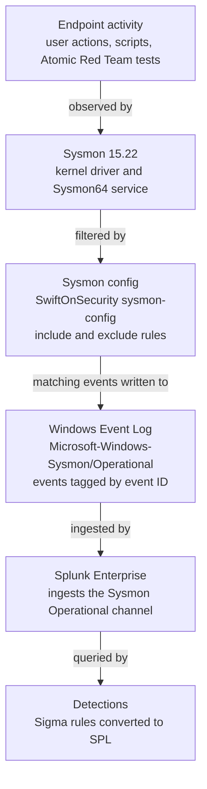

# Architecture

How telemetry moves through this lab, what the lab runs on, and where it cannot see. Build history, including what broke, is in [lab-build.md](lab-build.md). Build status is tracked in [ROADMAP.md](../ROADMAP.md).

---

## Telemetry pipeline

Each stage can drop data without raising an error. Sysmon only records what its config allows through, and Splunk can only search what reaches the channel. This is why the validation loop in [detection-standard.md](detection-standard.md) queries for the raw event before any rule is written. The 2026-09-12 entry in [lab-build.md](lab-build.md) records a case where the config stage was silently dropping EID 1 and EID 22.

The full pipeline was confirmed end to end on 2026-10-14: Sysmon events reach Splunk Enterprise 10.4.3 in `index=endpoint` with fields parsed by the Splunk Add-on for Sysmon. See the 2026-10-14 entry in [lab-build.md](lab-build.md).

## Lab specification

**Host:** Acer Aspire 14, Intel Core 5 120U, 16GB RAM, Windows 11. VirtualBox runs on the Native API execution engine because virtualization-based security could not be fully disabled on this hardware. See the 2026-09-09 entry in [lab-build.md](lab-build.md).

**Guest:** Windows 11 Enterprise LTSC Evaluation, build 26100.ge_release.240331-1435.

| Setting | Value |
| --- | --- |
| Name | soc-lab-win11 |
| Disk | 80 GB VDI, dynamically allocated |
| Memory | 6144 MB |
| vCPU | 2 |
| Chipset | ICH9 |
| Firmware | UEFI, Secure Boot enabled, TPM 2.0 |
| Network | NAT |
| Audio | Disabled |
| Hostname | DESKTOP-TSIOB4T (intended name VICTIM-01 was never set) |
| Local account | analyst |

## Why a single VM

The previous build on this host used multiple VMs and Wazuh. It failed with guest freezes and kernel soft-lockups, partly from running more guests than 16GB of RAM supports. That was the practical trigger for the change, but the single-VM design is also the more accurate model for what this lab is trying to detect.

A conventional multi-host range separates an attacker machine from a victim machine because it models an external adversary reaching into the network. Shadow AI usage and insider data movement do not work that way. The activity starts on the endpoint being monitored, under a legitimate user account, using tools already present on the machine: a browser, PowerShell, an archive utility, a desktop AI client. There is no separate attacker host in the real scenario, so adding one to the lab would produce telemetry that does not match what the detections need to catch.

For the same reason, attack generation happens on the monitored host. Atomic Red Team tests and manual commands run on the monitored VM itself, so the process trees, parent-child relationships, user context, and network connections in the telemetry originate where they would in a real insider or shadow-AI event.

The trade-off is that this lab does not cover lateral movement or other techniques that need a second host. Those are out of scope.

## Sysmon event IDs currently flowing

Verified on 2026-09-12 after switching to the SwiftOnSecurity config. Presence of an event ID means the config lets at least some events of that type through. It does not mean every event of that type is captured.

| Event ID | Name | Description |
| --- | --- | --- |
| 1 | Process creation | A process started. Provides `Image`, `CommandLine`, `ParentImage`, `Hashes`, `User`, and `ProcessGuid` |
| 3 | Network connection | A process made a TCP or UDP connection. Provides source and destination IP and port and the initiating `Image` |
| 4 | Sysmon service state changed | The Sysmon service started or stopped |
| 7 | Image loaded | A DLL or other module was loaded into a process. **Conflicting observations, cause not determined.** Observed on 2026-09-12 after the switch to SwiftOnSecurity, with a count of 23. On 2026-10-14, `Sysmon64.exe -c` reported "Image loading: disabled" under the same config. See Gap 8 in [telemetry-gaps.md](telemetry-gaps.md) |
| 10 | Process access | One process opened a handle to another. Used to detect credential and memory access |
| 11 | File create | A file was created or overwritten. Provides `TargetFilename` |
| 12 | Registry object added or deleted | A registry key or value was created or deleted |
| 13 | Registry value set | A registry value was modified. Provides `TargetObject` and `Details` |
| 16 | Sysmon config state changed | The Sysmon configuration was changed |
| 17 | Pipe created | A named pipe was created |
| 22 | DNS query | A process issued a DNS query. Provides `QueryName` and the initiating `Image` |

## Detection telemetry dependencies

Taken from the detection index in [README.md](../README.md). The last column compares each detection's dependencies against the event IDs verified above. A dependency marked not verified has not been confirmed present in this lab; it does not mean the source is known to be missing.

| # | Detection | Depends on | Dependencies verified present |
| --- | --- | --- | --- |
| 01 | Encoded PowerShell command | Sysmon EID 1 | Yes, with the PowerShell filtering caveat below |
| 02 | Egress to unsanctioned AI service | Sysmon EID 1, 3, 22 | Yes |
| 03 | Archive staging before egress | Sysmon EID 1, 11 | Yes |
| 04 | Clipboard capture volume anomaly | Sysmon EID 24 | No. EID 24 is not in the verified list |
| 05 | Ingress tool transfer via LOLBin | Sysmon EID 1, 3 | Yes |
| 06 | Bulk document read burst | Sysmon EID 11, WinEvent 4663 | Partial. EID 11 verified; 4663 requires object access auditing and has not been verified |
| 07 | Browser credential store access | Sysmon EID 10 | Yes |
| 08 | Registry Run key persistence | Sysmon EID 12, 13 | Yes |
| 09 | Failed logon burst then success | WinEvent 4625, 4624 | Not verified. Windows Security log, not Sysmon |
| 10 | Correlated: read burst, archive, egress | Multi-source | Depends on 03, 06, and 02 |

Telemetry being present is a prerequisite for a detection, not evidence that it works. Detections 01 and 02 have been validated against live telemetry. None is complete under [detection-standard.md](detection-standard.md), because no false positive rate has been measured and neither has a tuning history. Status for each is in the README index and [ROADMAP.md](../ROADMAP.md).

## Known blind spots

The full, maintained list is in [telemetry-gaps.md](telemetry-gaps.md). The most serious is that browser-based access to AI services produced no DNS or network events in testing on 2026-10-14.

**TLS hides payload content.** Sysmon EID 22 records the hostname queried and EID 3 records the connection, but traffic to AI services is TLS-encrypted and this lab has no interception. Detection 02 can establish that a connection to an AI service occurred, from which process, and how often. It cannot establish what data was sent. Content-level visibility requires a DLP agent, a CASB, or a TLS-inspecting proxy, none of which are part of this lab.

**PowerShell process creation filtering.** The SwiftOnSecurity Sysmon config deliberately excludes some PowerShell process creation events to reduce noise. Any encoded PowerShell invocation that falls inside those exclusions never produces an EID 1 event, so detection 01 will not see it and will not error. This is tracked as an open follow-up in the 2026-09-12 entry of [lab-build.md](lab-build.md): the config needs tuning, with a documented before and after, once detection 01 is validated.
